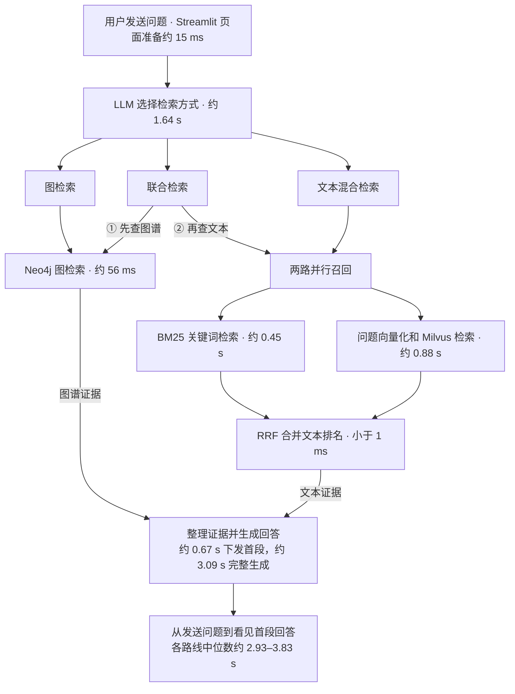

# HonorGuide

王者荣耀攻略问答。当前资料是艾琳、虞姬两篇 Markdown。Streamlit 提供攻略问答和效果测评。

```powershell
conda activate honorguide
python -m streamlit run frontend/app.py
```

在项目根目录运行后打开本地页面，按 `Ctrl+C` 停止。也可双击 `frontend/启动 HonorGuide.lnk`。两种入口任选其一，本地 Milvus Lite 数据目录每次由一个进程打开。[本地页面](http://127.0.0.1:8501)

`.streamlit/config.toml` 负责本地监听和终端日志设置。终端显示本地地址和警告或错误。

## 资料更新

首次搭建先安装 `requirements.txt`，复制 `.env.example` 到 `.env` 并填好模型和数据库配置。首次入库或修改 `data/docs/` 中的攻略后，点击侧栏的「更新知识库」按钮。

用 `HONORGUIDE_MILVUS_URI` 配置本地 Milvus 路径。旧 `.env` 中的 `MILVUS_URI` 仍可读取。

更新会依次读取攻略并分块、重建 BM25、生成向量并切换 Milvus 索引，再更新 Neo4j 图谱。更新时暂停新问答和测评。若中途失败，修复页面报告的问题后再点一次，三套数据构建完成后恢复查询。

页面首次打开时预加载 BM25 索引、结巴分词词典和 Milvus 集合，问答直接复用。每个新问题仍要分词，文档的词频和倒排表用已保存的索引。更换嵌入模型后，重启应用并更新知识库，让问题向量和索引使用同一个模型。

## 一次问答如何流转

图中耗时是索引预加载、连接复用和并行召回前的基线，取本机 11 次成功问答的中位数。各模块只统计实际执行该模块的请求。



联合检索按编号依次查图和文本。文本检索中的 BM25 和向量召回同时执行，收齐后再做 RRF。页面主表记录并行阶段的实际等待，分支明细单独显示。路由、问题向量化和流式生成共享一个同步模型客户端。

| 检索路径 | 样本数 | 服务端首段下发 | 发送到看见首段 | 服务端完整回答 |
| --- | ---: | ---: | ---: | ---: |
| 文本混合 | 5 | 3.77 s | 3.83 s | 6.04 s |
| 图检索 | 5 | 2.89 s | 2.93 s | 4.87 s |
| 联合检索 | 1 | 3.55 s | 3.59 s | 6.41 s |

图中模块耗时从进入该模块开始计时。从发送到看见首段的时间包含页面准备、路由、检索、生成首段、传输和浏览器渲染。缓存和接口响应会影响单次耗时，明细保存在 `data/evaluation/request_timings.jsonl`。

## 效果测评

参考答案和标注只在测评使用。无答案或无证据的题跳过忠实度和上下文指标。知识库、题目或模型更新后，选择「重新评测（覆盖结果）」，在同一版本上生成答案和评分。

## 文件结构

```text
HonorGuide/
├── .env                      # 本机配置和密钥
├── .env.example              # 配置模板，复制成 .env 后填写本机配置
├── .gitignore                # 排除密钥、生成数据和本地设置
├── .streamlit/config.toml    # Streamlit 本地监听和日志设置
├── config.py                 # 环境变量和数据路径
├── requirements.txt          # Python 依赖
├── README.md
├── frontend/
│   ├── app.py                # 问答、测评、更新入口和浏览器计时
│   ├── start.pyw             # Windows 启动脚本
│   └── 启动 HonorGuide.lnk    # 本机双击入口
├── rag/
│   ├── __init__.py
│   ├── pipeline.py           # 问答入口、语义路由、阶段计时
│   ├── generation.py         # 整理证据、流式生成、检查引用
│   ├── model_client.py       # 同步模型客户端连接池
│   ├── fusion.py             # 并行召回、RRF 融合
│   ├── documents.py          # 读取 Markdown、分块并落盘
│   ├── knowledge.py          # 协调整库重建和查询
│   ├── evaluate.py           # RAGAS 测评和断点续跑
│   ├── bm25/
│   │   ├── __init__.py
│   │   └── retriever.py      # 结巴分词、倒排索引、关键词检索
│   ├── vector/
│   │   ├── __init__.py
│   │   └── retriever.py      # Embedding、Milvus 索引与检索
│   └── graph/
│       ├── __init__.py
│       └── retriever.py      # 关系抽取、Neo4j 入库和查询
└── data/
    ├── docs/
    │   ├── ailing.md          # 艾琳攻略
    │   └── yuji.md            # 虞姬攻略
    ├── storage/
    │   ├── documents.json    # 完整父文档
    │   ├── chunks.json       # 切分后的文本块
    │   ├── bm25.json         # BM25 统计和倒排表
    │   ├── milvus.db/        # 本地向量库
    │   ├── neo4j/            # 本地图数据库和运行配置
    │   └── knowledge_revision.txt  # 整库更新后生成的版本标识
    └── evaluation/
        ├── questions.json    # 测评题、参考答案与预期证据
        ├── results.json      # 本地测评结果和断点
        └── request_timings.jsonl  # 本地问答耗时
```

`__init__.py` 标记 Python 包。数据库、测评结果、耗时日志和 `.lnk` 都是本机文件。读问答代码从 `rag/pipeline.py` 的 `ask()` 开始。
