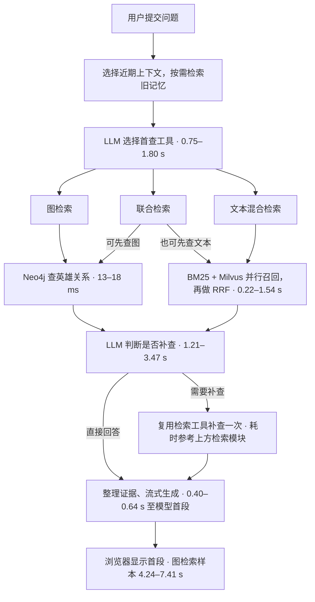

# HonorGuide

王者荣耀攻略问答 Agent，带跨重启记忆和 RAGAS 测评。资料目前覆盖艾琳和虞姬。

```powershell
conda activate honorguide
python -m streamlit run frontend/app.py
```

在项目根目录运行以上命令。打开本地页面后即可使用，在终端按 `Ctrl+C` 停止服务。[本地页面](http://127.0.0.1:8501)

首次使用先安装 `requirements.txt`，复制 `.env.example` 为 `.env` 并填写配置。首次入库或改完攻略后，点「更新知识库」。一次读取 Markdown，生成子块并重建 BM25、Milvus 和 Neo4j。更新失败后可再次点击重建。

## 问答流程与耗时

前端从记忆模块取得对话上下文并传给 Agent。Agent 依据 Skill 选择首查工具，拿到结果后判断是否补查。图、文本和联合是按实际调用归纳的三条路径。下方已有耗时取自加入记忆 RAG 前的三条服务端样本和两次浏览器图检索样本。[SKILL.md](skills/honorguide-answer/SKILL.md)



三条样本的服务端首段耗时为 2.83–5.69 秒。页面可看分段耗时和并行明细，日志写入 `data/evaluation/request_timings.jsonl`。

## 对话记忆

问答历史和关键词索引保存在 `data/memory/conversations.db`，记忆向量保存在 `data/memory/milvus.db/`。记忆模块自行选择最近三轮完整问答。问题有明确主题词且存在更早的历史时，用 SQLite FTS5 和 Milvus 分别召回至多 8 条，经记忆模块自己的 RRF 合并、去重后，在 2400 字符预算内补入旧问答。

每轮回答完成后，先将原文写入 SQLite，再将该轮问答向量写入 Milvus。问答片段和用于检索时的查询会发给已配置的嵌入服务。旧数据或失败的向量写入会按批补齐。向量路径失败时仍可用关键词历史。记忆嵌入模型由 `MEMORY_EMBEDDING_MODEL` 配置。Agent 用记忆理解用户情境，攻略结论依照本轮查到的攻略与图谱证据。

## 测评

「效果测评」用十道带参考答案的题运行 RAGAS 和引用审计，支持断点续跑。修改 Skill、模型、知识库或检索参数后，点「重新评测（覆盖结果）」生成同一版本的结果。

## 文件结构

```text
HonorGuide/
├── .env.example              # 本机配置模板
├── .gitignore                # 排除密钥、数据库与本机文件
├── .streamlit/config.toml     # 页面服务与日志配置
├── config.py                 # 读取 .env 和数据路径
├── requirements.txt          # Python 依赖
├── README.md                 # 启动方式、耗时流程与文件结构
├── frontend/
│   ├── app.py                # 页面入口、导航和知识库更新
│   ├── chat_page.py          # 流式问答、会话保存和浏览器计时
│   ├── browser_clock.js      # 首段渲染计时与提交锁
│   ├── evaluation_page.py    # 测评参数、进度和结果
│   └── render_answer.py      # 两个页面共用的回答、证据和耗时展示
├── skills/honorguide-answer/
│   ├── SKILL.md               # 选工具、补查、引用和拒答规则
│   └── scripts/tools.py       # 两个工具的定义、校验和执行
├── agent/
│   ├── run_qa_agent.py          # 加载 Skill、选择工具、决定是否补查
│   └── generate_cited_answer.py # 整理证据、流式生成并校验引用
├── rag/
│   ├── search_bm25_keywords.py  # 攻略倒排索引与关键词检索
│   ├── search_milvus_vectors.py # 攻略向量索引和检索
│   ├── search_neo4j_graph.py    # 克制关系抽取、入库与检索
│   ├── run_hybrid_text_search.py # 攻略关键词和向量的并行检索
│   ├── rank_with_rrf.py         # 攻略候选排名融合
│   ├── tokenize_search_text.py  # 攻略分词与文本清理
│   ├── connect_milvus.py        # 攻略 Milvus 连接和加载缓存
│   └── knowledge/
│       ├── prepare_documents.py      # 读取攻略、分块并保存
│       └── rebuild_knowledge_base.py # 更新索引并管理并发访问
├── memory/
│   ├── __init__.py                  # 对外提供加载、保存和选择上下文
│   ├── store_conversation_history.py # SQLite 对话和 FTS5 关键词索引
│   └── search_conversation_memory.py # 记忆向量索引、召回与上下文选择
├── evaluation/
│   ├── evaluate_with_ragas.py   # 评分、引用审计与断点续跑
│   └── record_request_timing.py # 阶段耗时与日志
├── infrastructure/
│   ├── call_model_api.py        # 复用模型 HTTP 客户端
│   └── open_milvus_client.py    # 打开指定的 Milvus 数据库
└── data/
    ├── docs/                   # 原始 Markdown 攻略
    ├── storage/                # 攻略块、BM25、攻略 Milvus、Neo4j
    ├── memory/                 # 对话 SQLite、记忆 Milvus
    └── evaluation/             # 测评题、结果和问答耗时
```

`frontend/` 把 `memory/` 返回的上下文传给 `agent/`。Agent 通过 Skill 调用 `rag/` 的攻略工具。`memory/` 和 `rag/` 各自管理检索、排序和持久化，共用模型 API 客户端和连接工具。
