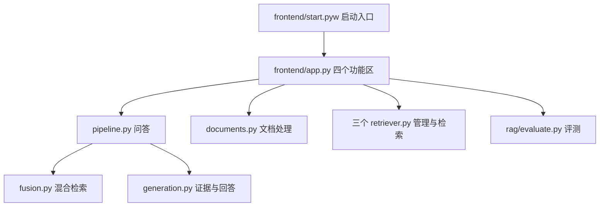

# HonorGuide

本地运行的《王者荣耀》攻略问答项目，当前收录艾琳、虞姬两篇攻略。向量数据库使用 Milvus，默认采用适合本地 Windows 开发的 Milvus Lite 3.2.2。所有业务操作统一通过 Streamlit 页面完成，包括文档处理、索引构建、图谱管理、检索调试和效果评测。

## 启动与使用

首次克隆到新电脑时，在项目根目录安装依赖并创建本地配置：

```powershell
conda create -n honorguide python=3.12
conda activate honorguide
pip install -r requirements.txt
Copy-Item .env.example .env
```

在 `.env` 中填写可用的模型名称、API 密钥及 Neo4j 连接信息。通过页面启动本地 Neo4j 时，还需要安装 Neo4j 和 JDK 21，并配置对应路径。随后运行 `python -m streamlit run frontend/app.py`，按“知识库管理”页面的顺序处理文档、构建索引和图谱。

本机已有配置和数据时，也可以使用双击入口：

1. 在项目的 `frontend/` 目录中双击 **启动 HonorGuide.lnk**。
2. 启动器会检查本地服务；服务已运行时直接打开页面，未运行时在后台启动。
3. 浏览器地址：`http://127.0.0.1:8501`。

快捷方式使用当前机器的 `honorguide` 环境；`frontend/start.pyw` 也会从 Conda 环境登记文件中寻找该环境。需要已有的 Python 依赖，版本记录在 `requirements.txt`。启动日志保存在系统临时目录的 `honorguide-streamlit.log`。

`.gitignore` 排除了真实 `.env`、`data/storage/`、生成的评测结果和本机 `.lnk` 快捷方式；这些本地文件不会被删除。仓库保留 `.env.example`、原始攻略和评测题目。首次克隆不包含预建数据库，需要在页面完成初始化；双击快捷方式仅用于当前电脑。

也可以在项目根目录通过终端启动页面：

```powershell
conda activate honorguide
python -m streamlit run frontend/app.py
```

`frontend/app.py` 负责网页和交互；`frontend/start.pyw` 是可选启动器，负责后台启动服务并打开浏览器。`.pyw` 的 Python 语法与 `.py` 相同，Windows 通常使用 `pythonw.exe` 打开它，从而不显示控制台。使用终端命令时直接运行 Streamlit 页面即可。评测逻辑归入 `rag/evaluate.py`，由页面调用。

代码按“一个模块一个 Python 文件”组织，三个检索目录各有一个核心 `retriever.py`。`__init__.py` 负责包标识，业务模块通过函数供页面调用。原先的 `__main__.py` 和命令行解析代码已移除。

## 目录与文件作用

```text
HonorGuide/
├── README.md                   # 目录说明和页面操作指南
├── requirements.txt            # Python 依赖
├── .env                        # 模型接口、密钥和 Neo4j 配置
├── .env.example                # 可提交的配置模板，不含真实密钥
├── .gitignore                  # 排除密钥、本地数据库、生成文件和机器专用入口
├── config.py                   # 配置模块：读取 .env，定义统一的数据路径
│
├── frontend/                   # 页面与桌面启动入口
│   ├── app.py                  # 页面模块：四个功能区、状态、进度和错误提示
│   ├── start.pyw               # 启动模块：检查服务、后台启动、打开浏览器
│   └── 启动 HonorGuide.lnk      # 双击入口，调用本机 Python 环境
│
├── rag/                        # RAG 核心模块
│   ├── __init__.py             # RAG 包标识
│   ├── documents.py            # 文档模块：攻略读写、元数据、分块、JSON 保存
│   ├── evaluate.py             # 评测模块：RAGAS 指标、引用审计、检索检查和逐指标断点
│   ├── fusion.py               # 融合模块：BM25/向量两路召回及 RRF 融合
│   ├── generation.py           # 生成模块：模型调用、证据编号、提示词与回答
│   ├── pipeline.py             # 问答模块：路由、完整问答流程、阶段计时与日志
│   ├── bm25/                   # 关键词检索目录
│   │   ├── __init__.py         # 包标识
│   │   └── retriever.py        # BM25 模块：分词、TF/IDF、倒排表和检索
│   ├── vector/                 # 向量检索目录
│   │   ├── __init__.py         # 包标识
│   │   └── retriever.py        # 向量模块：Embedding、Milvus 集合、HNSW 构建与查询
│   └── graph/                  # 图检索目录
│       ├── __init__.py         # 包标识
│       └── retriever.py        # 图模块：连接、启动、抽取、校验、入库和查询
│
└── data/                       # 原始资料和持久化数据
    ├── docs/                   # 攻略来源，更新内容后在页面重新处理
    │   ├── ailing.md           # 艾琳攻略
    │   └── yuji.md             # 虞姬攻略
    ├── storage/                # 文档与文本检索索引
    │   ├── documents.json      # 完整父文档及元数据
    │   ├── chunks.json         # 文本块及元数据，chunk_id 对应 Milvus 记录
    │   ├── neo4j/              # Neo4j 数据与本项目运行配置
    │   │   ├── databases/      # neo4j 业务库与 system 管理/认证库
    │   │   ├── dbms/           # DBMS 元数据及初始化认证文件
    │   │   ├── transactions/   # 两个数据库的事务日志
    │   │   ├── conf/           # 启动时自动生成的本项目配置
    │   │   ├── logs/           # Neo4j 运行日志及启动日志
    │   │   ├── run/            # 运行状态文件
    │   │   └── server_id       # Neo4j 实例标识
    │   ├── milvus.db/          # Milvus Lite 数据目录，包含持久化数据与索引
    │   ├── request_timings.jsonl # 请求耗时事件日志，不保存问题、回答或密钥
    │   └── bm25.json           # BM25 统计和倒排表
    └── evaluation/             # 评测输入与输出
        ├── questions.json      # 10 道题、reference、预期证据、回答要点和评测口径
        └── results.json        # RAGAS 版本、回答、证据、逐指标分数、引用审计及断点
```

`__pycache__/` 是运行产生的字节码缓存，不属于业务模块。旧 `ui/`、根目录 `evaluation/`、代码缓存和 `data/storage/index.faiss` 已清理；现有页面位于 `frontend/app.py`，评测代码位于 `rag/evaluate.py`，有效评测资料保留在 `data/evaluation/`。启动器已设置 `PYTHONDONTWRITEBYTECODE=1`，新启动的页面进程不再产生代码缓存。数据库目录中的 WAL、日志和状态文件由 Milvus、Neo4j 自行管理。

## 页面一：攻略问答

侧栏选择“攻略问答”，输入英雄名称及问题。支持：

| 模式 | 检索方式 | 适用问题 |
| --- | --- | --- |
| 自动选择 | 规则选择模式 | 日常提问 |
| 文本混合检索 | BM25 + 向量 + RRF | 技能、装备、打法 |
| 图检索 | Neo4j 关系查询 | 克制方向、原因和条件 |
| 文本 + 图联合检索 | 文本检索与图查询 | 同时涉及关系和攻略的复合问题 |

侧栏可调整最终文本块数 `top_k`（默认 3）和每路召回数 `recall_k`（默认 10）。答案下方可展开引用原文、图关系、检索分数、查询计划和耗时。历史记录用于展示，每次提问独立检索。

回答生成期间可以继续输入和编辑下一条问题；发送按钮和 Enter 提交暂时禁用。回答完成或失败后恢复发送，已输入的草稿保留，不会自动提交。

Milvus 会核对分块内容、记录数和嵌入模型签名；不匹配时提示重新构建。BM25 通过文件更新时间检查是否需要重建。自动或联合模式在图查询失败时可以回退到文本检索，`used_mode`、`notes` 记录实际情况。

### 流式回答与首 token 耗时

回答使用模型接口的原生流式输出。每次回答下方的“首 token 耗时与阶段明细”区分三个时间：

| 计时 | 起点 → 终点 |
| --- | --- |
| 用户等待总耗时 | 浏览器按 Enter 或点击发送 → 首段非空回答文本的近似首次绘制 |
| 服务端首段下发耗时 | 提交回调 → 首段文本交给 Streamlit 下发队列 |
| 模型首段文本耗时 | 发起模型请求 → SDK 收到首段非空回答文本，包含网络及请求重试 |

服务端记录页面准备、路由、图连接/名单读取/问题解析/关系查询、BM25 加载/分词/评分、Milvus 加载校验、问题向量化、向量检索、RRF、证据和提示词整理、模型等待以及首段下发。阶段顺序执行且不重叠，表格截断到首段下发时刻，其和等于服务端首段下发耗时。未执行的分支不计入。完整回答生成和引用校验另计，不混入首 token 总耗时。

浏览器计时使用同一页面的 `performance.now()`，通过 [Streamlit v2 组件](https://docs.streamlit.io/develop/api-reference/custom-components/st.components.v2.component)监听原生聊天提交、答案 DOM 变化及双 `requestAnimationFrame`。这是首次绘制的近似值，不是物理屏幕刷新时刻；后台标签页可能延后。组件在回答完成后回传先前采集的时间，避免回传触发重跑而打断生成。服务端与浏览器分别用各自的单调时钟，不对比两台机器的绝对时间。传输、调度和绘制等剩余开销只报告合计，不伪造单独的网络耗时。

“首 token”实际指首个非空文本增量，可能包含多个 token；角色、用量、推理字段和纯空白不算。没有证据时显示本地提示，不产生模型 TTFT。流中断或引用校验失败会明确标出未完成的回答。浏览器计时未采集时显示“尚未采集”，不补成零。

日志在 `data/storage/request_timings.jsonl`：每行一个事件，`server_complete` 保存服务端计时，浏览器回传后追加 `browser_first_render`。两行通过同一个 `request_id` 关联，统计请求数时应按编号去重；浏览器数据可能晚于完整回答耗时。失败请求标记 `status=error`。日志仅保存计时、模式和状态；清空页面问答历史不会删除日志。已有评测记录不补造首 token 时间。

## 页面二：知识库管理

本机已有数据时可直接使用；首次克隆或修改 `data/docs/` 中的攻略后，按页面顺序操作：

1. **处理文档**：设置分块字符数和重叠字符数，保存父文档及文本块。默认 400/50，重叠必须小于分块字符数。
2. **连接 / 检查 Milvus**：检查本地 Milvus Lite 或已配置的独立服务，查看集合与当前状态。
3. **构建 Milvus 向量库**：生成嵌入，将文本、元数据、分块编号和向量存入集合，建立 HNSW / COSINE 索引。
4. **构建 BM25 索引**：计算词频、IDF、文档长度和倒排表并保存。
5. **启动 / 检查图数据库**：使用侧栏按钮启动已配置的本地 Neo4j。
6. **预览抽取关系**：从完整攻略的对抗小节调用模型抽取并校验，在页面查看结果。
7. **构建 / 更新图谱**：重新抽取、校验并合并入库，显示英雄数、关系数和来源证据数。

文档处理后清理 BM25 缓存，Milvus 每次检查内容签名。修改攻略后，应重建两个文本索引并核对图谱证据；修改嵌入模型后，应重建 Milvus 向量库。

Milvus 使用固定逻辑别名 `honorguide_chunks`，实际集合名称带构建批次后缀。重建时先完整创建、写入、索引并加载新集合，成功后切换别名；失败时保留旧集合。查询结果直接携带数据库保存的文本和元数据，不再根据本地文件行号匹配。

默认数据位置为 `data/storage/milvus.db/`。Milvus Lite 3.x 的 `.db` 路径实际是目录，数据库自身管理 WAL、数据段和索引。业务代码只调用 PyMilvus；`faiss-cpu` 是 Milvus Lite 的底层依赖。为适配本机扩展加载限制，已固定兼容的 FAISS 和 PyArrow 官方版本。迁移前的旧 `index.faiss` 文件已删除，当前应用通过 Milvus 管理向量数据与索引。

Milvus Lite 适合本地开发；切换到独立服务时，在 `.env` 设置 `MILVUS_URI` 和可选的 `MILVUS_TOKEN`，然后重新启动页面、连接并构建集合。不同部署支持的功能存在差异，参见 [Milvus Lite 官方文档](https://milvus.io/docs/milvus_lite.md)。

同一方向的英雄对保留一条 `COUNTERS` 关系，多篇来源按属性列表的相同下标对应保存。克制表示有条件的机制优势，不代表必胜，也不自动具有传递性。

Neo4j 的活动数据目录已迁移到本项目：

- `data/storage/neo4j/databases/neo4j/`：节点、关系、属性及索引。
- `data/storage/neo4j/databases/system/`：数据库管理和认证数据。
- `data/storage/neo4j/transactions/`：事务日志。
- `data/storage/neo4j/conf/`、`logs/`、`run/`：本项目的配置、日志和运行状态。

`config.py` 中的 `NEO4J_DATA_DIR` 根据项目路径计算。页面启动数据库时，`rag/graph/retriever.py` 会生成配置，通过 `server.directories.data` 和 `server.directories.transaction.logs.root` 指定上述目录，并设置 `NEO4J_CONF`。这些运行配置由启动函数管理。已运行的本地实例若使用其他数据目录，页面会报告错误，避免误用旧实例。

`NEO4J_HOME`、`JAVA_HOME` 继续指向项目外的 Neo4j/JDK 程序安装目录。项目通过 Bolt 驱动查询，由 Neo4j 服务操作项目内的数据文件。原安装目录的 `data/` 完整保留为迁移前备份，当前实例已使用项目内的副本。

## 页面三：检索调试

选择 BM25、向量、RRF 混合或图关系，输入问题后点击“执行检索”。页面显示检索块、分数、排名，或图查询计划和关系证据。

调试检索不会调用对话模型生成答案；向量和混合检索仍会调用嵌入接口编码问题。纯图查询不使用文本检索参数。

## 页面四：效果评测

页面展示现有 10 道题、汇总指标和单题记录：

- **运行 / 继续评测**：复用已有回答；每个 RAGAS 指标单独保存，成功指标不重复计算。旧自定义分数单独放入各题的 `previous_evaluation`，不混入新分数。
- **重新评测（覆盖结果）**：清空当前结果记录并重新评测全部题目，会调用模型接口。
- 运行中显示逐题进度，失败时保留断点。
- “查看单题结果”可查看答案、证据、RAGAS 标准输入、参考答案、逐指标分数和引用审计。

评测使用 **RAGAS 0.4.4** 的 `ragas.metrics.collections` API，评审模型和嵌入模型沿用 `.env` 的配置，通过兼容 OpenAI 的接口调用。依赖已列入 `requirements.txt`。普通问答页面不会初始化 RAGAS；进入实际评分时才加载框架。

| 类型 | 指标 | 实现与含义 |
| --- | --- | --- |
| RAGAS 内置 | Faithfulness | 根据实际检索上下文，判断回答中的事实能否得到支持 |
| RAGAS 内置 | Answer Relevancy | 框架根据答案生成三个问题，用嵌入相似度和 noncommittal 判断评估相关性 |
| RAGAS 内置 | Context Precision | 根据参考答案判断上下文是否有用，并评估有用内容的排序；不等于 Precision@3 |
| RAGAS 内置 | Context Recall | 参考答案中的信息有多少能由检索上下文支持 |
| 项目检索检查 | 文本 Hit@3 / Recall@3、图关系 Recall、路由准确率 | 使用原先标注的可替代文本证据组和有向三元组确定命中 |
| RAGAS LLM 项目扩展 | Citation Precision / Recall、0～2 分覆盖评分、恰当拒答率 | 先确定句子/列表单元和实际引用编号，再通过 RAGAS 的结构化 LLM 接口审计、按计数汇总；不冒充内置指标 |

`questions.json` 的 `reference` 是逐题编写的参考答案，仅交给 Context Precision / Recall；`key_points` 仅交给引用与问题覆盖审计。这些字段不传入检索或回答生成，也不传入内置 Answer Relevancy。引用审计只以实际提供的证据为依据，检查每个固定单元、引用编号和出现次数，避免模型自行拆句重复计数。

图 RAG 也参与评测：图关系的头尾英雄、原因、适用条件和证据原文被转换为上下文字符串，与文本块一起输入 RAGAS。方向正确性和预期三元组是否命中仍单独检查。RAGAS 文本指标不直接衡量整张图的完整性、图模式或 Cypher 性能。

RAGAS 指标按有效题取算术平均，页面同时显示有效题数和不适用题数。无答案题或无检索证据时，Faithfulness / Context Precision / Context Recall 标记为不适用，不伪造 0 或 1；检索遗漏仍能通过项目检索检查看出来。内置 Answer Relevancy 仍按原逻辑运行，并另报有答案题的均值。引用指标按全体引用出现次数、需引用单元数汇总；分母为零时显示“—”。接口失败或非有限分数保留错误和断点，不补成零分。

断点签名覆盖评审/嵌入模型、RAGAS 版本、协议版本、题目/参考答案和实际答案/证据。输入改变时重新计算该题指标。继续评测复用已保存的答案，评估的是这些历史回答；若要评估当前检索生成链路，点击“重新评测（覆盖结果）”。

评测局限与读分方式：

- 当前实现文本 Hit@3、按题平均的 Recall@3，尚未加入 Precision@3；关键证据列表不等于所有相关文本的完整列表。
- 生成和自动评审使用同一模型，存在共同偏差；参考答案需要人工维护，只有 10 道题，不代表通用效果。
- Answer Relevancy 可能把恰当的拒答识别为 noncommittal 并给低分，需结合恰当拒答率阅读；相似度不等于事实正确率。
- Faithfulness 检查回答与检索上下文的一致性，不直接检查引用编号是否指向正确证据；引用支持率与覆盖率通过单独审计提供。
- 自动路由已覆盖“克制 + 技能/被动/普攻/位移”等复合问题；仍采用关键词规则，复杂表述可在检索调试中检查，并手动选择检索方式。

指标定义可查阅 [RAGAS Faithfulness](https://docs.ragas.io/en/latest/concepts/metrics/available_metrics/faithfulness/)、[Answer Relevancy](https://docs.ragas.io/en/latest/concepts/metrics/available_metrics/answer_relevance/)、[Context Precision](https://docs.ragas.io/en/latest/concepts/metrics/available_metrics/context_precision/) 和 [Context Recall](https://docs.ragas.io/en/latest/concepts/metrics/available_metrics/context_recall/)。

## 配置与阅读顺序

`config.py` 统一读取根目录 `.env`：

- 模型：`BASE_URL`、`API_KEY`（也支持 `DASHSCOPE_API_KEY`）、`LLM_MODEL`、`EMBEDDING_MODEL`。
- 向量库：`MILVUS_URI`（默认本地 `data/storage/milvus.db`；独立服务示例 `http://127.0.0.1:19530`）、`MILVUS_TOKEN`（本地默认空）、`MILVUS_COLLECTION`（固定逻辑别名，默认 `honorguide_chunks`）。
- 数据库：`NEO4J_URI`、`NEO4J_USERNAME`、`NEO4J_PASSWORD`、`NEO4J_DATABASE`。
- 本地启动：`NEO4J_HOME`、`JAVA_HOME`，指向已安装的 Neo4j 和 JDK。

快捷方式绑定本机环境位置；项目移到其他电脑后，需要重新配置环境及快捷方式目标。模型客户端会读取当前进程的代理环境变量，TLS 连接中断时可先检查本机代理和接口可达性。

推荐从 `rag/pipeline.py` 的 `ask()` 开始，再看 `fusion.py`、三个 `retriever.py`、`generation.py` 和 `documents.py`。页面调用位于 `frontend/app.py`，评测调用位于 `rag/evaluate.py`。


